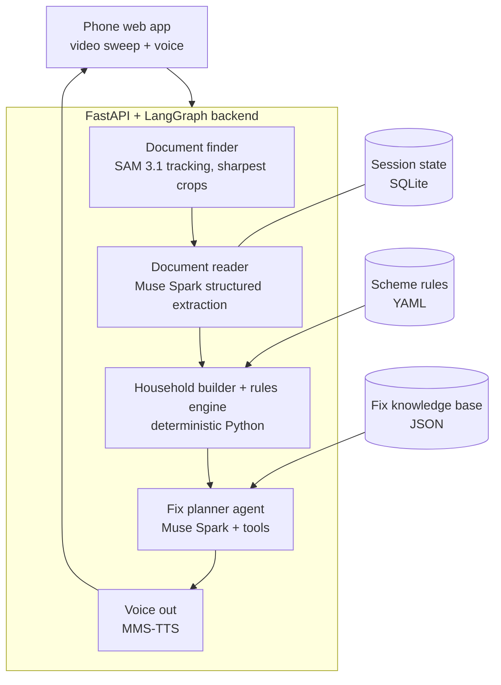

# Kaagaz — Product Requirements Document

**Meta Global AI Developer Hackathon · Indie Developer track · Theme: Build for Your World**
**Owner:** Dhanushragav Shanmugam · **Build window:** Oct 26 (10:30 PM IST) → Nov 5 (7:30 AM IST)
**Status:** Draft v1 — check against the official hackathon rules once they're published

---

## 1. The problem

Many families who qualify for welfare schemes still lose them because of paperwork: a name spelled differently across two documents, an income certificate that has expired, a blurry upload, a missing page. Nobody catches these problems when the person applies. The rejection arrives weeks later, and by then the family has lost a trip to the office, a fee, and sometimes the benefit itself.

Most people affected can't easily read forms or type, and many share a basic phone. Any solution has to work by voice and camera, not by forms.

## 2. What Kaagaz does

Kaagaz is a voice-first agent. The person sweeps a phone camera once across their family's documents, and Kaagaz tells them in Marathi or Hindi:

1. which documents it found and read
2. what's wrong or missing, for each family member
3. how to fix each problem: a pre-drafted self-declaration where one applies, which office to visit, and what to bring

It can also read a rejection letter and turn it into a plan for resubmitting.

## 3. Users

| User | Description | What they need |
|---|---|---|
| **Primary: the citizen** | Low literacy, speaks Marathi or Hindi, basic smartphone | To understand what's wrong and how to fix it without reading anything |
| **Helper** | A family member, a Common Service Centre operator, or a field worker holding the phone | Clear capture guidance and a summary they can act on |
| **Judge (demo audience)** | Watches a live demo or video | To see the flow from a messy table to a fix plan in about a minute |

## 4. Goals and non-goals

**Goals**
- Find and read 5 document types from one video sweep, including blurry frames.
- Catch inconsistencies between documents and gaps against eligibility rules for 10 Maharashtra schemes.
- Make every eligibility decision with deterministic code that can be explained. The LLM never decides eligibility.
- Turn every issue into a concrete fix the person can act on, delivered by voice.
- Measure accuracy on a benchmark of synthetic documents with deliberately planted errors.

**Non-goals (for the hackathon)**
- Submitting applications to government portals.
- Processing real citizens' documents. Only synthetic, watermarked test documents are used.
- Supporting every scheme or every Indian language.
- Building a native mobile app.

## 5. Scope

| Item | Hackathon scope |
|---|---|
| Schemes | 10 Maharashtra and central schemes whose document requirements overlap heavily (chosen from official sources during prep) |
| Document types | Ration card, Aadhaar, income certificate, caste certificate, bank passbook |
| Languages | Voice in and out in Marathi and Hindi; on-screen text in English for the demo |
| Household size | Up to 6 members |
| Data | Synthetic documents only, all watermarked "SPECIMEN" |

## 6. User flow

1. The person opens the web app and picks a language.
2. Kaagaz asks by voice, "Spread your family's papers on a table and slowly move the camera over them."
3. While recording, a check in the browser plays short pre-recorded prompts such as "slower" or "come closer" when frames are blurry.
4. The video is uploaded. A progress screen shows each stage as it finishes.
5. Kaagaz reads out a summary: "I found 7 documents for 4 family members. 2 problems need fixing."
6. For each problem, it explains the fix by voice, with a card on screen and a downloadable draft declaration.
7. The person can ask follow-up questions by voice, such as "Where is the tehsil office?" or "What is this scheme?"
8. Optional: they photograph a rejection letter, and Kaagaz turns it into a resubmission plan.

## 7. Functional requirements

### 7.1 Capture (frontend)
- Record up to 45 seconds of video with the browser's camera API and send it to the backend.
- Record voice clips for questions.
- Run a blur and motion check in the browser and play pre-recorded guidance prompts. This must not call the LLM.
- Show a progress screen for each pipeline stage.

### 7.2 Document finder
- Sample frames from the video (about 3–5 per second).
- Use SAM 3.1 with text prompts such as "document" or "card" to segment each document and track it across frames.
- For each tracked document, choose the 2–3 sharpest frames using the variance of the Laplacian.
- Straighten each crop using the mask outline (perspective correction).
- **Fallback:** if the API version struggles, run SAM 3 open weights on a Modal GPU behind the same interface.

### 7.3 Document reader
- Send only the cleaned crops to Muse Spark, never the full video.
- Step 1: identify the document type. Step 2: extract fields using structured output with a fixed schema for each type.
- Use the multiple frames of each document together, so text that's unclear in one frame can be read from another.
- Validate every output with Pydantic and retry once with the validation error if it fails.
- Mask ID numbers in the extracted text before storing anything.

### 7.4 Household builder (deterministic)
- Use the ration card's member list to create the household.
- Link the other documents to members by name and date of birth.
- Name matching: transliterate Devanagari to Latin script, then fuzzy-match with rapidfuzz.
  - Score ≥ 90: automatic match.
  - Score 70–90: Muse Spark decides, with a reason that's logged.
  - Score < 70: no match.

### 7.5 Rules engine (deterministic)
- Load scheme rules from YAML files.
- Check three things:
  - **consistency**: do names and dates of birth agree across documents?
  - **validity**: have any certificates expired?
  - **eligibility**: does each member meet each scheme's conditions?
- Return a list of issues. Each issue has a type, severity, the member and document affected, and the evidence used.
- No LLM calls at this stage.

### 7.6 Fix planner agent
- Muse Spark runs a tool-calling loop over the issue list.
- Tools: `lookup_fix_procedure`, `draft_declaration`, `get_office_info`, `read_rejection_letter`.
- Every fix must come from the curated fix knowledge base. If no procedure matches, the agent must say "I don't know how to fix this — ask at the office," not invent one.
- Output: a fix plan ordered by priority, with plain-language explanations for voice.

### 7.7 Voice
- **Input:** send audio clips directly to Muse Spark, which accepts audio.
- **Output:** convert text to speech with Meta's MMS-TTS (Marathi and Hindi models), running on CPU.
- **Fallback:** AI4Bharat Indic TTS if MMS quality isn't good enough.
- Scheme descriptions are kept in the cached system prompt, so general questions are answered without RAG.

## 8. Non-functional requirements

| Area | Target |
|---|---|
| End-to-end time | Under 60 seconds from finished upload to first spoken summary for a 7-document household |
| Privacy | Raw frames held in temporary storage only and deleted after processing; only masked, extracted fields stored |
| Cost | Stay within the $150 Meta credits; log token use per request; use prompt caching for schemas and system prompts |
| Reliability | Every LLM output validated; retry with backoff; the demo path must work after a cold start |
| Explainability | Every issue links to the document and field it came from |

## 9. Tech stack

| Layer | Choice | Why |
|---|---|---|
| Backend | Python 3.11, FastAPI | You know it well; fast to build |
| Orchestration | LangGraph | Matches the mix of fixed pipeline and one agent; state, checkpointing, and retries built in |
| Model calls | OpenAI Python SDK pointed at the Meta Model API | The API is OpenAI-compatible; calling it directly avoids wrapper problems with video and audio input |
| LLM | Muse Spark (latest model ID from Meta's docs) | Multimodal input, structured output, tool calling, 1M-token context |
| Segmentation | SAM 3.1 via the Meta Model API (fallback: SAM 3 open weights on Modal) | Video tracking of documents from text prompts |
| TTS | MMS-TTS (Meta open weights) | Marathi and Hindi support, counts as Meta tooling, runs on CPU |
| Vision utilities | OpenCV, ffmpeg | Frame sampling, blur scoring, perspective correction |
| Matching | rapidfuzz, Indic transliteration library | Matching names across scripts |
| Validation | Pydantic v2 | Checks every structured model output |
| Storage | SQLite (LangGraph checkpointer and sessions); YAML and JSON in the repo | The data is small; no vector database needed |
| Frontend | React, TypeScript, Vite, as a mobile web app | You know it; no app-store delays |
| Hosting | Vercel or Netlify (frontend); Hugging Face Spaces with Docker (backend); Modal if credits are granted | Free, HTTPS by default (required for camera access), no personal cloud account needed |
| Coding assistant | Muse Code | Part of the Meta toolkit; mention it in the submission |

### Why no RAG or vector database
The knowledge Kaagaz needs is small and structured: 10 schemes, 5 document types, and about 15 fix procedures. Rules belong in version-controlled YAML that code checks deterministically. Scheme descriptions fit in a cached prompt. RAG would bring back the guessing this product is designed to remove. If Kaagaz grows to hundreds of schemes, Postgres with pgvector is the upgrade path.

## 10. Architecture



### LangGraph state (shared across all nodes)

```python
class KaagazState(TypedDict):
    session_id: str
    language: Literal["mr", "hi"]
    frames_dir: str                          # temporary; deleted after reading
    documents: list[DocumentCrop]            # one per tracked document
    extractions: list[DocumentExtraction]    # validated Pydantic objects
    household: Household                     # members + linked documents
    issues: list[Issue]                      # from the rules engine
    fix_plan: list[FixStep]                  # from the fix planner
    audio_out: list[str]                     # paths to TTS clips
    usage: TokenUsage                        # cost tracking
```

### Agents and tools

| Component | Type | Model | Tools / inputs | Output |
|---|---|---|---|---|
| Voice front | Light agent | Muse Spark (audio in) | `run_pipeline`, `answer_scheme_question`, `explain_issue` | Routes speech to the pipeline or answers directly |
| Document reader | LLM step | Muse Spark (image in, structured out) | Document crops + type schemas | `DocumentExtraction` |
| Name adjudicator | LLM step | Muse Spark | Two name strings + context | Match yes/no + reason (borderline cases only) |
| Fix planner | Agent (tool loop) | Muse Spark | `lookup_fix_procedure`, `draft_declaration`, `get_office_info`, `read_rejection_letter` | `list[FixStep]` |
| Document finder | Model call | SAM 3.1 | Video frames + text prompt | Tracked masks → crops |
| Rules engine | Deterministic | — | Scheme YAML + household | `list[Issue]` |
| TTS | Model call | MMS-TTS | Text + language | Audio clips |

## 11. Data formats

### Scheme rule (YAML) — example structure, not real rules
```yaml
id: example_scheme
name: { en: "Example Scheme", mr: "...", hi: "..." }
source_url: "https://<official government page>"
last_verified: 2026-10-24
required_documents: [ration_card, aadhaar, income_certificate, bank_passbook]
eligibility:
  - field: household.annual_income
    op: "<="
    value: 0            # fill in from the official source
  - field: member.age
    op: between
    value: [0, 0]       # fill in from the official source
validity:
  income_certificate_max_age_days: 0   # fill in from the official source
```
Every rule must link to an official source and record the date it was last checked.

### Fix procedure (JSON)
```json
{
  "issue_type": "name_mismatch",
  "applies_to": ["aadhaar", "ration_card"],
  "steps": { "en": ["..."], "mr": ["..."], "hi": ["..."] },
  "office": "office_type_id",
  "carry": ["..."],
  "template": "self_declaration_name.html",
  "source_url": "https://<official source>"
}
```

### Issue (Pydantic)
```python
class Issue(BaseModel):
    type: Literal["name_mismatch", "dob_mismatch", "expired", "missing_document",
                  "unreadable", "ineligible", "rejection_reason"]
    severity: Literal["blocker", "warning"]
    member_id: str | None
    documents: list[str]
    evidence: dict          # the exact fields and values that triggered it
    scheme_ids: list[str]
```

## 12. Repository layout

```
kaagaz/
├── backend/
│   ├── app/main.py              # FastAPI routes
│   ├── graph/                   # LangGraph nodes + state
│   ├── models/                  # Pydantic schemas
│   ├── clients/meta.py          # Muse Spark + SAM 3.1 client (one place)
│   ├── vision/                  # frames, blur score, perspective fix
│   ├── rules/engine.py          # deterministic checks
│   ├── matching/names.py        # transliteration + fuzzy match
│   ├── tts/                     # MMS-TTS wrapper
│   └── Dockerfile
├── data/
│   ├── schemes/*.yaml
│   ├── fixes/*.json
│   └── templates/*.html
├── eval/
│   ├── synthetic/               # generated households + ground truth
│   └── run_eval.py
├── frontend/                    # React + Vite
└── README.md
```

## 13. Evaluation

The benchmark is 30–50 synthetic households. Each one has documents rendered from HTML templates, watermarked "SPECIMEN," and has 0–3 deliberately planted errors with a ground-truth file. Around 10 of them are printed and photographed on a cluttered table for realism.

| Metric | Definition | Target |
|---|---|---|
| Document detection rate | Documents found ÷ documents present | ≥ 95% |
| Field extraction accuracy | Correct key fields ÷ total key fields | ≥ 90% |
| Issue catch rate | Planted errors found ÷ planted errors | ≥ 85% |
| False alarm rate | Incorrect issues ÷ total issues raised | ≤ 10% |
| Hallucinated fixes | Fix steps not in the knowledge base | 0 |
| End-to-end time | Upload → first spoken summary | < 60 s |

`run_eval.py` runs the whole benchmark and saves a results table. These numbers go into the README and the demo video.

## 14. Hosting and deployment

- **Frontend:** Vercel or Netlify, deployed automatically from GitHub.
- **Backend:** Docker image on Hugging Face Spaces (free CPU tier). Secrets stored in the Space settings.
- **GPU fallback:** a Modal function for SAM 3 open weights, only if the API version doesn't work well enough and credits are granted.
- **Before the demo:** send a request to the backend 5 minutes ahead so it isn't cold-starting during the live run.

## 15. Execution plan

### Prep (Oct 20–26) — research, data, and experiments only
Check the official rules first. Until they confirm pre-existing work is allowed, keep this week's work out of the product repo.

- [ ] Choose 10 schemes; write their rules from official sources (with source links and check dates)
- [ ] Write the fix knowledge base (10–15 common issues)
- [ ] Build HTML templates for the 5 document types; generate the synthetic households and ground truth
- [ ] Print and photograph about 10 households for realistic test videos
- [ ] Test SAM 3 open weights on Colab with document videos
- [ ] Test MMS-TTS quality in Marathi and Hindi
- [ ] Read the Meta Model API docs: structured output, tool calls, image, video, and audio input, caching
- [ ] Draft the extraction schemas and system prompts

### Build (all times IST)

| Day | Focus | Done when |
|---|---|---|
| Mon Oct 26 (night) | Kickoff, keys, credits; first Muse Spark + SAM 3.1 calls | Both APIs respond from your machine |
| Tue Oct 27 | Document finder | A video becomes clean crops, one per document |
| Wed Oct 28 | Document reader | All 5 types extract to valid Pydantic objects |
| Thu Oct 29 | Household builder + rules engine | Issues produced for synthetic households |
| Fri Oct 30 | Fix planner agent + knowledge base + templates | A fix plan with a drafted declaration |
| Sat–Sun Oct 31–Nov 1 | Frontend, voice in and out, end-to-end, rejection letters | The full flow works on a phone |
| Mon Nov 2 | Run the evaluation; fix the biggest failures | Metrics table generated |
| Tue Nov 3 | Stop adding features; deploy; error handling; polish | Public URL works after a cold start |
| Wed Nov 4 | Demo video, README, submit | Submitted by Wednesday evening |

### What to cut if behind (in this order)
1. Rejection-letter reading
2. Live capture guidance (play fixed instructions instead)
3. Household graph (check one person instead of a family)
4. Hindi (keep Marathi only)

**Core path that must work:** video in → documents found and read → mismatch caught → fix explained by voice.

## 16. Risks and mitigations

| Risk | Likelihood | Impact | Mitigation |
|---|---|---|---|
| Muse Spark reads Marathi or Hindi text poorly | Medium | High | Test on day 1; ask at Meta office hours; fall back to an Indic OCR step before the LLM |
| SAM 3.1 struggles to separate documents that touch or overlap | Medium | High | Test in prep; guide people to spread documents out; fall back to SAM 3 on Modal |
| SAM 3.1 API format differs from expectations | Medium | Medium | Hide it behind one `segmenter` interface with two possible backends |
| Credits run out | Low–Medium | High | Send only crops; cache prompts; track usage per request; use small test sets |
| MMS-TTS sounds too robotic | Medium | Low | AI4Bharat Indic TTS as a backup |
| Official rules restrict pre-existing work | Unknown | High | Keep prep to data and research until the rules are clear |
| The ID-masking claim is hard to achieve visually | Medium | Medium | Never store raw images; mask digits in text; visual masking is a stretch goal |
| Running out of time as a solo builder | High | High | Follow the cut list; feature freeze on Nov 3; consider taking Nov 3–4 off |

## 17. Demo plan (25% of the score)

- **Video length:** under 3 minutes, unless the official rules say otherwise.
- **Story:** a family's papers spread on a table → one camera sweep → Kaagaz speaks in Marathi → it catches a name mismatch and an expired income certificate → it shows the drafted self-declaration and office directions → a closing screen with evaluation metrics.
- **For the live demo:** keep a recorded backup ready in case the live run fails, and warm up the backend first.
- **Mention Meta tooling explicitly:** SAM 3.1 tracking video, Muse Spark reading across multiple frames, audio input, and tool-calling, MMS-TTS, and Muse Code.

## 18. Open questions

- What do the official rules say about pre-existing work, demo length, and repo requirements?
- What's the exact request format for SAM 3.1 through the Meta Model API (video input or frame by frame)?
- Will partner credits (Modal, Baseten, Fireworks) be granted?
- Which 10 schemes? Decide during prep based on how much their document requirements overlap.
