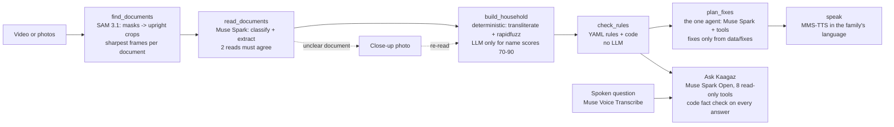

# Kaagaz: a voice-first check of a family's welfare papers

> DRAFT. Fill in every [PLACEHOLDER] before submitting.

| Field | Value |
|---|---|
| Hackathon | Meta Global AI Developer Hackathon |
| Track | [PLACEHOLDER: confirm track: Indie Developer, "Build for Your World"] |
| Team | [PLACEHOLDER: team name, members, roles] |
| Live app | [PLACEHOLDER: Netlify URL] |
| Repository | [PLACEHOLDER: GitHub URL] |
| Demo video | [PLACEHOLDER: video URL] |
| Bonus categories entered | [PLACEHOLDER: e.g. Best Agentic, Best Build on Meta Open Weight Models] |
| Other required fields | [PLACEHOLDER: any further fields from the submission form] |

## The problem

Many families who qualify for welfare schemes still lose them because of paperwork. A name is spelled one way on the
Aadhaar card and another on the caste certificate. A date of birth differs by a year. An income certificate is too
old, or a family member is missing from the ration card. Nobody catches this when the family applies. The rejection
comes weeks later, after a trip to the office, a fee, and sometimes a lost benefit.

The people most affected often can't easily read forms or type, and many share one basic phone. A fix has to work by
camera and voice, in their own language, and it must never make up rules or office procedures.

## Who it's for

- **The family:** low literacy, speaks Marathi (or Hindi, English, Tamil, Telugu or Kannada), basic smartphone. They
  need to hear what is wrong and what to do, without reading anything.
- **A helper holding the phone:** a relative, a Common Service Centre operator or a field worker. They need clear
  capture guidance and a plan they can act on.

Scope today: Maharashtra, 5 schemes (Ladki Bahin, PM Ujjwala, Ramai Awas, Sanjay Gandhi Niradhar, Shravanbal) and
4 document types (ration card, Aadhaar card, income certificate, caste certificate).

## How it works

The family films their papers spread on a table, or adds up to 12 photos. Kaagaz finds each document, reads it,
links documents to the people on the ration card, checks them against each other and against each scheme's rules,
and an agent writes a fix plan that is read aloud.

1. **Find** (`find_documents`). SAM 3.1 segments documents in the video or in each photo. Masks become 4 corners and
   an upright crop (text orientation checked). For video, the 2-3 sharpest fully visible frames of each document are
   kept. Crops stay in memory; uploads are deleted as soon as finding is done.
2. **Read** (`read_documents`). Muse Spark classifies each crop and extracts its fields into a Pydantic schema, with
   one retry on a validation error. Decision fields (names, date of birth, income, category, card colour, dates) count
   only if two reads agree. Otherwise the document goes on a "clearer photo" list. Identity numbers are masked
   before anything is cached.
3. **Household** (`build_household`). Deterministic code. Ration-card members become the household. Other documents
   are linked by name (transliterated, then rapidfuzz) and date of birth: a score of 90 or more is a match, 70-90 is
   asked of the LLM (the reason is logged), and under 70 is no match. A name mismatch is re-read before it is
   reported.
4. **Rules** (`check_rules`). YAML rules in `data/schemes/` (each value with its status and source URL) are checked by
   `rules/engine.py`. Each member and scheme gets one of four outcomes: eligible on documents, fix first, check at
   the office, or not eligible. There are no LLM calls in this step.
5. **Plan** (`plan_fixes`). The one true agent. A Muse Spark tool loop asks the family about conflicts (e.g. "which
   date of birth is right?") and picks procedures from `data/fixes/` (8 procedures, each fact with a source). If
   nothing matches, it says "ask at the office". Code checks the plan against the knowledge base before it is
   accepted.
6. **Speak** (`speak`). Sentences come from reviewed templates, not from the agent. MMS-TTS speaks them in the
   session's language.

After the plan, **Ask Kaagaz** answers typed or spoken questions about the five schemes and the family's own check.
It runs on Muse Spark Open with 8 read-only tools. Code checks every fact in an answer before it is shown. Spoken
questions are transcribed by Muse Voice Transcribe into the text box, so the family checks the words before sending.

Stack: Python 3.11, FastAPI, LangGraph, Pydantic v2, OpenCV, ffmpeg. The frontend is React + TypeScript (mobile
first). The backend runs on Modal as one container and the frontend on Netlify. Logged-in checks are saved to
Postgres (Neon).

## Meta models used and why

| Model | What it does in Kaagaz | Why this model | Where it is not trusted |
|---|---|---|---|
| **SAM 3.1** (Meta Model API) | Finds every document in a video sweep or photo; its masks give the corners for upright crops; the live thumbnails show what it found | One text prompt ("document") finds paper of any layout, overlapping or on patterned cloth, and tracks it across video frames | Its finds are checked by code: too-small boxes and duplicates are dropped; documents swapped in the same box are split; anything not read as a known type is listed as "unidentified", not guessed |
| **Muse Spark** (Meta Model API, `muse-spark-1.3`) | Reads each crop (classify + structured extraction); re-reads disputed names; boxes Aadhaar numbers so thumbnails can blur them; the fix-planning agent; translation of UI strings | Strong at Devanagari plus English documents; 99.4% of fields right on our reader eval (vs 98.8% for 1.1); handles tool calling for the planner | It never decides eligibility. Decision fields need two agreeing reads. Its plan is verified against `data/fixes/` before use; spoken sentences come from templates |
| **Muse Spark Open** (open weights, on Baseten) | The Ask Kaagaz agent; borderline same-person calls (name scores 70-90); back-translation and meaning check of translations | Open weights for the conversational agent; a different model from the reader, so translation is checked by a second model | Every Ask answer is fact-checked by code (numbers, schemes, offices, fees, eligibility against the rules engine, language). After one failed retry the reply is "not sure" plus the check's own line. A daily token budget caps it |
| **Muse Voice Transcribe** | Spoken questions to Ask Kaagaz, and spoken answers to the family's questions (with buttons as the main path) | Handles Marathi, Hindi, mixed Marathi-English and the three Dravidian languages, with a language bias | Transcripts go into the text box to check; they are never sent by themselves. Spoken answers are matched only to numbered options. Transcripts are not cached or logged |
| **MMS-TTS** (Meta, open weights, CPU) | Speaks the question, the plan and Ask answers in mr, hi, en, ta, te, kn | Open models with a voice for every one of our six languages; runs on CPU in the same container | Speaks only template sentences and fact-checked answers; numbers and dates are spelled out by code first |

## Safety design

- **The LLM never decides eligibility.** Only `rules/engine.py` does, from YAML values that the developer copied from
  official sources (each with a status: verified, unverified or conflicting). Unverified values are shown that way.
- **No invented procedures.** Fixes come only from `data/fixes/`. Offices, fees and time limits in a plan are checked
  against it. Facts not yet verified are spoken as "please confirm this at the office". Where nothing matches, the
  plan says to ask at the office.
- **Ask Kaagaz is fact-checked by code on every answer**: numbers (including number words), scheme names, offices,
  fees, eligibility claims (compared with the rules engine), overclaims, language and script, length, and ID
  numbers. After one retry the reply is "not sure" with the check's own line. Questions in another script are refused
  by code.
- **Privacy.** Aadhaar digits are masked before anything is cached. Identity-card thumbnails show the number blurred
  where the vision model boxed it; with no box they show an icon. Uploads and frames are deleted after finding; crops
  live in memory for the session's hour. Guest checks are never stored. Saved checks keep no ID numbers, phone
  numbers are HMAC-hashed, and "Delete my data" removes everything.
- **Demo-only data.** Every document in the repo, the evals and the demo is synthetic and watermarked SPECIMEN. The app
  says so.
- **Limits.** Rate limits on uploads, logins and questions. A daily Baseten token budget (default 5M tokens): when it
  is used up, Ask says it is unavailable, and vision and agent calls fall back to Muse Spark.
- **Load.** At most 4 checks run at once. Further checks wait in line, and the app says "Kaagaz is busy, you're next
  in line" instead of waiting silently.

## Evaluation

**What was tested on what.** Almost every eval uses **synthetic SPECIMEN documents** (rendered, then made photo-like
with blur, glare, rotation and JPEG noise) and **synthetic voices** (MMS-TTS clips), not real people. The one
real-input test was a phone filming documents shown on a laptop screen. It **failed 9 of 9 videos** ("documents not
clear" or "no documents found"; every crop was rotated 90°). After the Phase 9c fixes (upright crops, track splits,
cut-off documents read, triage, photo mode), real video 727 gave **5 of 6 documents clear and a plan**. A real phone
test with printed documents: [PLACEHOLDER: results of the printed-paper phone test, if done].

Result files are in `eval/results/`.

| Eval | Data | Result | File |
|---|---|---|---|
| Reader | 58 photo-like documents | 58/58 classified, 641/645 fields right (99.4%), 4 wrong | `reader_muse-spark-1.3_20261028-235531.json` |
| Finder + reader | 4 synthetic sweep videos, 29 documents | 29/29 found, crop IoU ≈ 0.96, 0 wrong decision fields | `finder_document_20261029-011211.json` |
| Photo mode | EV001-EV010, one photo per document | 73/74 documents right | `photos_20261101-013939.json` |
| Household, truth (perfect reader) | 29 households (EV012 held out) | **31/31 planted errors caught, 0 false alarms** | `household_truth_20261101-145450.json` |
| Household, end to end | 29 households, 219 documents | **31/31 caught**; 13 false alarms (6 blocker, 7 "confirm"), all from misread names | `household_e2e_20261101-145507.json` |
| Fix planner | 10 EV households with issues | 10/10 plans passed verification first time, 0 fallbacks | `fix_planner_20261029-195345.json` |
| Ask Kaagaz | 49 questions, 6 languages (incl. 8 adversarial) | 48 handled right, 1 "not sure", **0 wrong answers shown** | `ask_20261101-134752.json` |
| Ask by voice | Synthetic MMS-TTS clips | WER en 0.06 / hi 0.19 / mr 0.25; ta 0.30 / te 0.50 / kn 0.18; right answers 11/12 and 8/9 | `asr_20261101-033631.json`, `asr_20261101-134935.json` |

**Phase 12 change to the eval set.** EV012 is now the app's sample family, so it was taken out of the eval set
(`eval/eval_set.py`). Only the household eval had included it.

| Household eval | Before (30 households) | After (29, without EV012) |
|---|---|---|
| Truth mode | 32/32 caught, 0 false alarms | 31/31 caught, 0 false alarms |
| End to end | 32/32 caught, 13 false alarms (6 blocker, 7 confirm) | 31/31 caught, 13 false alarms (6 blocker, 7 confirm) |

**The sample family (EV012) through the real pipeline.** "Try with a sample family" runs EV012's 7 synthetic photos
through the same photo mode as an upload. One photo, the father's caste certificate, is deliberately motion-blurred,
so the close-up loop shows. As read, the matrix has all four outcomes: eligible (Dattatray: Ramai Awas, Sanjay Gandhi
Niradhar; Omkar: Shravanbal), fix first (Lata: dates of birth differ between her Aadhaar card and caste certificate,
the planted error), check at the office (Omkar: Ramai Awas) and not eligible. The blurred certificate is listed for a
clearer photo, and the bundled close-up re-plans in about 4 s.

**Speed and load** (local copy pinned to 4 cores; production has 4 physical cores):

| | Result |
|---|---|
| Sample, nothing cached (cold) | first document 24.7 s, plan 62.0 s |
| Sample, cached (warm), any of 6 languages | first spoken sentence ~9 s, plan ~15 s |
| Real upload, nothing cached (deployed, Oct 29) | first plan step 66 s |
| 1 / 3 / 5 / 10 simultaneous sample checks | plan median 13.3 / 18.4 / 21.1 / 30.2 s, 0 errors |
| Same, before caching decoded SAM masks | 44 / 93 / 123 / 210 s |

The load test found that Meta's pure-Python mask decoder takes ~5 s per mask. Decoded masks are now cached by a hash
of the mask payload (the cached SAM response already holds the same mask). That cut a warm sample check from 44 s to
13 s on 4 cores.

**What review caught that the checks did not.**
- **The Lata answer.** In development, Ask Kaagaz told a family to correct Lata's Aadhaar card although they had
  said its spelling was right. The answer passed the fact check (every fact in it was true) and was caught on review.
  The prompt now defers mismatches to the plan, and the case is in the eval.
- **Translations.** 26 Tamil, Telugu and Kannada strings were fixed on review. 8 of them were not flagged by any
  automatic check: for example, "the name has a spelling mistake" where the app only knows the spellings differ, and
  "1 step is open" for "1 step left" (`docs/TRANSLATION_REPORT.md`). [PLACEHOLDER: confirm who reviewed the
  translation fixes; the report records the reviewer as Claude Code, not a native speaker.]

**Languages, honestly.** The Marathi voice templates were reviewed by a native speaker [PLACEHOLDER: reviewer name /
credit]. The Hindi and Marathi UI strings are machine-drafted. Hindi, Tamil, Telugu and Kannada are machine-translated
(Muse Spark translates; Muse Spark Open back-translates and checks the meaning), and the app labels ta/te/kn as
machine-translated.

## Known limitations

- **Evaluated on synthetic data.** No real family's documents were used, by design. Real-paper performance rests on
  one laptop-screen test and [PLACEHOLDER: printed-paper test].
- **Speed of a real upload.** An uncached upload takes about 66 s to the first plan step (upload, then SAM and
  reads); only the cached sample is fast.
- **One container.** Sessions live in memory, so the backend runs as one Modal container. Capacity is a few checks at
  once, and more wait in line.
- **Demo login.** It sends no SMS, so a phone number works like a username (the app says so). Real OTP is the first
  change before any real deployment.
- **Guest sessions.** A guest check can be viewed by anyone holding its random session ID during its one-hour life.
- **Retention.** Saved checks are kept for 365 days; guest checks are never stored.
- **Rule data.** Some scheme values are marked unverified or conflicting, and the app shows them that way. The scheme
  YAML has no verified "where to apply" yet, so Ask tells the family to ask at the office.
- **Voice.** Recognition was measured on synthetic voices only. Telugu is the least clear voice in the round trip
  (WER 0.50). In one Phase 12 run, a synthetic Marathi clip came back with a stray Bengali syllable (the answer was
  still right).
- **Name misreads** cause the remaining false alarms (e.g. प्रियांका read as प्रियंका). These are shown as "confirm"
  for the family to compare, never blocking.

## What's next

1. Test with printed and real-format documents on several phones, with consenting families and a field partner.
2. Real OTP login, and storage that keeps sessions across containers, so the backend can scale past one container.
3. Verified "where to apply" and office details per district, from official sources.
4. Native-speaker review of Hindi, Tamil, Telugu and Kannada; recordings from real voices for the speech evals.
5. More schemes and the bank passbook; reading rejection letters into a resubmission plan.

[PLACEHOLDER: anything else the submission form asks for, e.g. the license note for MMS-TTS (CC-BY-NC 4.0) and
acknowledgements]
